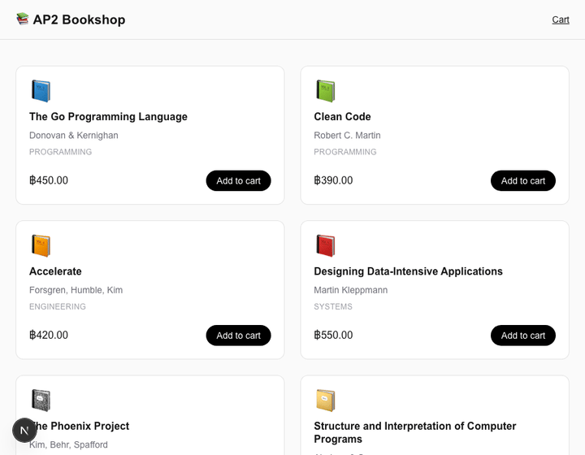

# AP2 Agentic Payment Bookshop

Workshop repo: an online book seller built with **Next.js**, where checkout is progressively handed to an agent using **Google's AP2 (Agent Payments Protocol)** for authorization mandates, settling money via **Stripe**.

Each lesson lives on top of the last. Every lesson's [docs/lessons](docs/lessons) write-up (in Thai) covers: goal, what was built, why it was built that way, what it unlocks, and alternatives considered — plus an architecture diagram and a demo GIF/screenshot.

## Getting started

```bash
npm install
npm run dev
```

Open [http://localhost:3000](http://localhost:3000).

## Lessons

| # | Lesson | Demo |
|---|--------|------|
| 1 | [โครงร่างร้านหนังสือ (Bookshop skeleton)](docs/lessons/lesson-01-bookshop-skeleton.md) — catalog + cart, no agent yet |  |

More lessons (Intent Mandate, Cart Mandate, human-in-the-loop approval, Payment Mandate + Stripe, signature verification, webhooks, failure/dispute scenarios) land as the workshop progresses — see [docs/lessons](docs/lessons).

## Stack

- **Frontend**: Next.js (App Router) + Tailwind
- **Protocol**: [AP2](https://github.com/google-agentic-commerce/AP2) mandates (Intent / Cart / Payment)
- **Settlement**: Stripe
- **Backend** (introduced from Lesson 5 onward): TypeScript (Next.js API routes) for orchestration/HTTP glue; Go reserved for any component that needs to run as a standalone service outside the Next.js process (e.g. a signature-verification microservice)
