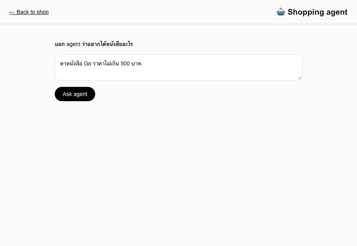
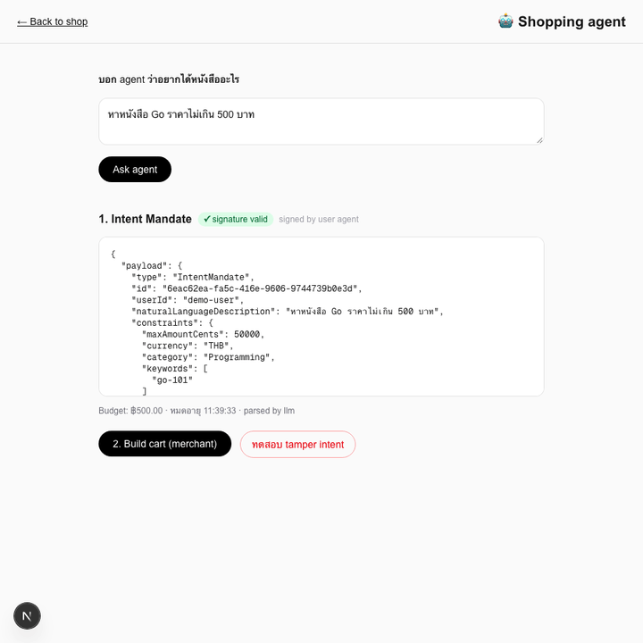
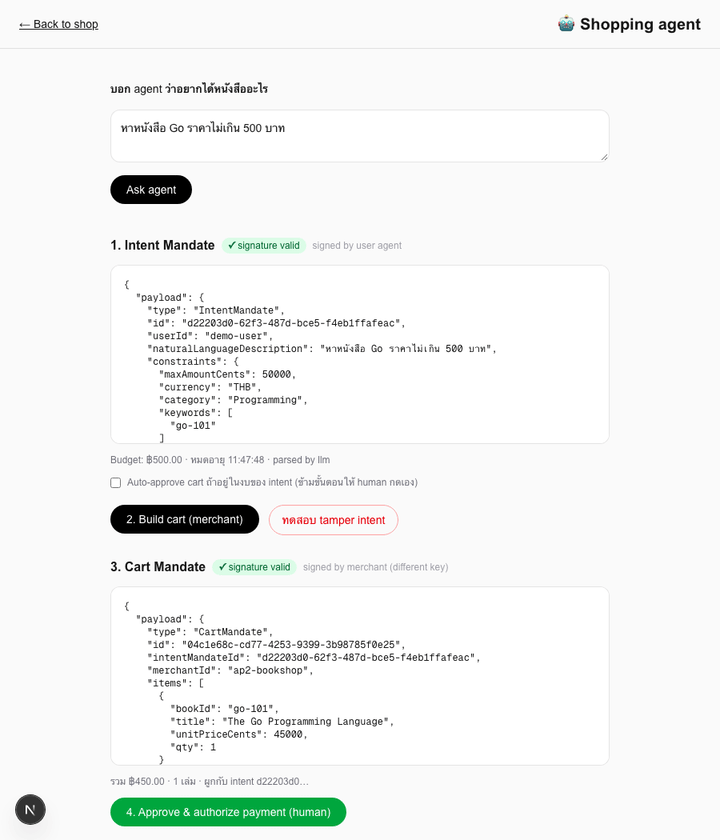
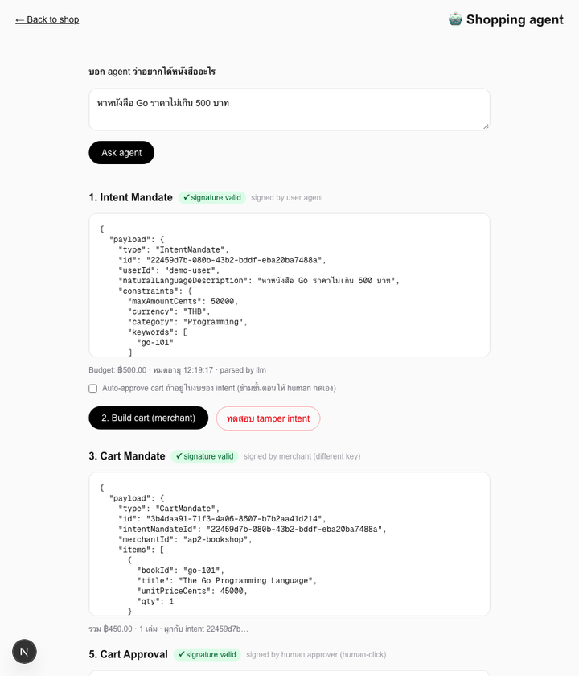
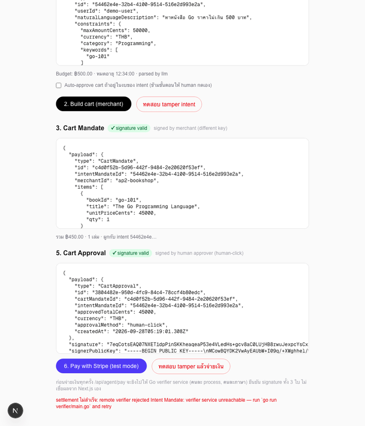
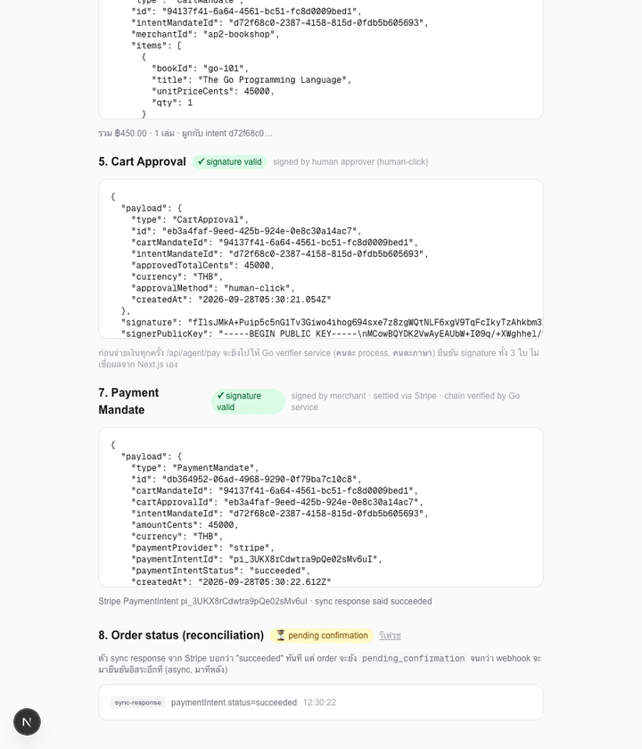
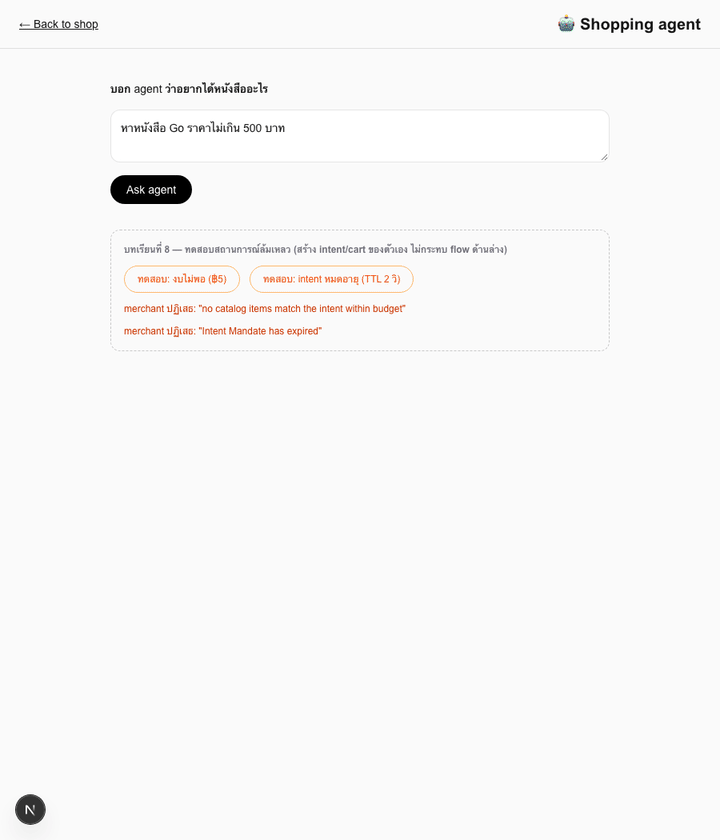

# AP2 Agentic Payment Bookshop

Workshop repo: an online book seller built with **Next.js**, where checkout is progressively handed to an agent using **Google's AP2 (Agent Payments Protocol)** for authorization mandates, settling money via **Stripe**.

Each lesson lives on top of the last. Every lesson's [docs/lessons](docs/lessons) write-up (in Thai) covers: goal, what was built, why it was built that way, what it unlocks, and alternatives considered — plus an architecture diagram and a demo GIF/screenshot.

## Getting started

```bash
npm install
npm run dev
```

Open [http://localhost:3000](http://localhost:3000).

From Lesson 6 onward, the payment flow requires the standalone Go verifier to be running alongside the dev server:

```bash
go run verifier/main.go
```

From Lesson 7 onward, forward real Stripe webhooks to the dev server with the Stripe CLI (prints a `whsec_...` — put it in `.env` as `STRIPE_WEBHOOK_SECRET`):

```bash
stripe listen --forward-to localhost:3000/api/webhooks/stripe
```

## Lessons

| # | Lesson | Demo |
|---|--------|------|
| 1 | [โครงร่างร้านหนังสือ (Bookshop skeleton)](docs/lessons/lesson-01-bookshop-skeleton.md) — catalog + cart, no agent yet |  |
| 2 | [Intent Mandate](docs/lessons/lesson-02-intent-mandate.md) — shopping agent turns a chat message into a signed, verifiable Intent Mandate (Ed25519) |  |
| 3 | [Cart Mandate](docs/lessons/lesson-03-cart-mandate.md) — merchant verifies the Intent Mandate, builds a cart within budget, and signs it with its own key |  |
| 4 | [Human-in-the-loop approval](docs/lessons/lesson-04-human-approval.md) — a human (or a policy-checked auto-approve) signs off on the Cart Mandate with a third, distinct key before payment can happen |  |
| 5 | [Payment Mandate + Stripe](docs/lessons/lesson-05-payment-mandate.md) — verifies the full intent → cart → approval chain, settles via a real Stripe test-mode PaymentIntent, and signs the result as a Payment Mandate |  |
| 6 | [Signature verification & chain of custody](docs/lessons/lesson-06-chain-of-custody.md) — a standalone Go service independently re-verifies every mandate before settlement; fails closed if it's unreachable |  |
| 7 | [Webhooks + reconciliation](docs/lessons/lesson-07-webhook-reconciliation.md) — an order stays `pending_confirmation` until an independent Stripe webhook (not the synchronous response) confirms it |  |
| 8 | [Failure & dispute scenarios](docs/lessons/lesson-08-failure-scenarios.md) — insufficient budget, an expired mandate, a declined card, and a simulated dispute resolved with the mandate chain as evidence |  |

That's the full workshop — see [docs/lessons](docs/lessons) for all write-ups.

## Stack

- **Frontend**: Next.js (App Router) + Tailwind
- **Protocol**: [AP2](https://github.com/google-agentic-commerce/AP2) mandates (Intent / Cart / Payment)
- **Settlement**: Stripe (test mode), via `STRIPE_SECRET_KEY` + `STRIPE_WEBHOOK_SECRET` — see `.env.example`
- **Backend**: TypeScript (Next.js API routes) for orchestration/HTTP glue (from Lesson 2); **Go** for the standalone signature-verification service (`verifier/`, from Lesson 6) that runs as its own process, independent of the Next.js app
- **Optional LLM**: OpenRouter (Gemini 3.8 Flash) for intent parsing, via `OPENROUTER_API_KEY` — falls back to a deterministic rule-based parser when unset
