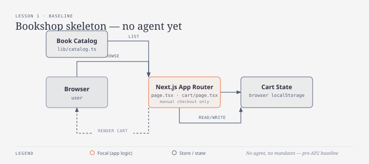

# บทเรียนที่ 1 — โครงร่างร้านหนังสือ (Bookshop skeleton)

## เป้าหมาย (Goal)
สร้างร้านหนังสือด้วย Next.js แบบธรรมดา (แค็ตตาล็อก + ตะกร้า) โดย **ยังไม่มี agent และยังไม่มี AP2 mandate ใดๆ** — เพื่อใช้เป็น baseline "manual checkout" ไว้เทียบกับทุกบทเรียนถัดไป

## สิ่งที่สร้าง
- `types/book.ts`, `lib/catalog.ts` — แค็ตตาล็อกหนังสือแบบ static เก็บใน memory
- `app/page.tsx` — หน้าแสดงรายการหนังสือ พร้อมปุ่ม "Add to cart"
- `lib/cart.ts`, `app/cart/page.tsx` — สถานะตะกร้าเก็บใน `localStorage` ของ browser และปุ่ม "Checkout (manual, no agent yet)" ที่ยังกดไม่ได้จริง

## ทำไมถึงทำแบบนี้
- **ใช้ localStorage แทนการมี backend จริงสำหรับตะกร้า**: จุดโฟกัสของบทเรียนที่ 1 คือ "หน้าร้าน" ไม่ใช่เรื่อง persistence ถ้าใส่ database หรือ API route ตั้งแต่ตอนนี้ จะทำให้แนวคิดของ AP2 ที่จะใส่เพิ่มทีหลังถูกกลบด้วย setup ที่ไม่เกี่ยวข้อง
- **ปุ่ม checkout เป็น disabled ไม่ทำอะไรจริง** แทนที่จะลบทิ้งไปเลย: เพื่อทำเครื่องหมายจุดที่ agent จะเข้ามาแทนที่ในบทเรียนที่ 2 เป็นต้นไป การเก็บปุ่มไว้แบบเห็นชัดว่า "ยังไม่ทำงาน" ช่วยให้เทียบ "ก่อน" กับ "หลัง" ได้ชัดเจนตอน diff โค้ด

## ต่อยอดอะไรได้ / เอาไปใช้ทำอะไร
- มี "manual flow" ที่จับต้องได้ไว้ชี้ให้เห็นว่าทำไมต้องมี AP2: ทุกขั้นตอนที่ human คลิกเองตรงนี้ คือขั้นตอนที่ agent จะต้องพิสูจน์ทีหลังว่าตัวเองมีสิทธิ์ทำ (authorized)
- มี UI (แค็ตตาล็อก + ตะกร้า) ที่นิ่งแล้ว บทเรียนถัดไปใช้ต่อได้เลยโดยไม่ต้องแก้ มีแค่ checkout path ที่จะขยายเพิ่ม

## ทางเลือกอื่นที่พิจารณาแล้ว
- **ทำ cart แบบ server-render พร้อม database จริง (เช่น SQLite/Postgres) ตั้งแต่แรก** — ดูสมจริงกว่า แต่ต้องเพิ่ม persistence layer และ migration ก่อนที่จะเขียน AP2 แม้แต่บรรทัดเดียว จึงเลื่อนไปทำตอนที่บทเรียนจริงๆ ต้องการ order record แบบถาวร (บทเรียนที่ 7)
- **ข้าม baseline แบบ manual แล้วเริ่มจาก agent เลย** — ทำได้เหมือนกัน แต่จะเสีย contrast ที่ทำให้เห็นชัดว่าทำไม AP2 ต้องแยก Intent/Cart/Payment mandate ออกจากกัน — จะดูเหมือน "protocol เพื่อ protocol" มากกว่าการแก้ปัญหาจริง

## หมายเหตุเรื่อง backend
บทเรียนนี้ยังไม่มี backend เมื่อถึงจุดที่ต้องมี (เริ่มบทเรียนที่ 5 สำหรับ settlement กับ Stripe และบทเรียนที่ 6 สำหรับ verify signature ของ mandate) จะเลือกใช้ **TypeScript (Next.js API routes)** สำหรับส่วนที่เป็น orchestration/HTTP glue เป็นหลัก และสำรอง **Go** ไว้สำหรับส่วนที่ต้องแยกเป็น service/verifier อิสระนอกโปรเซส Next.js (เช่น signature-verification microservice ในบทเรียนที่ 6) — ตัดสินใจเป็นบทเรียนไป ขึ้นกับว่าส่วนนั้นจำเป็นต้องรันแยกจากตัวเว็บแอปหรือไม่

## แก้บั๊กระหว่างทดสอบ
ตอนทดสอบจริงใน browser พบว่าปุ่ม "Add to cart" เพิ่มจำนวนเป็น 2 ทั้งที่กดครั้งเดียว สาเหตุคือ React Strict Mode (dev mode) เรียก `useEffect` สองครั้ง ทำให้ `addToCart` ถูกเรียกซ้ำ แก้ด้วยการเก็บ `useRef` guard และเคลียร์ query param `?add=` ออกจาก URL ทันทีหลัง add สำเร็จ (ดู [app/cart/page.tsx](../../app/cart/page.tsx))
