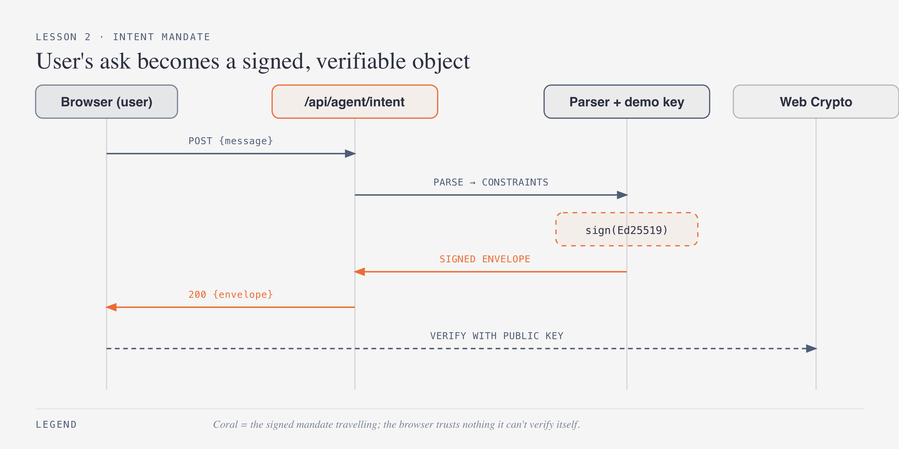
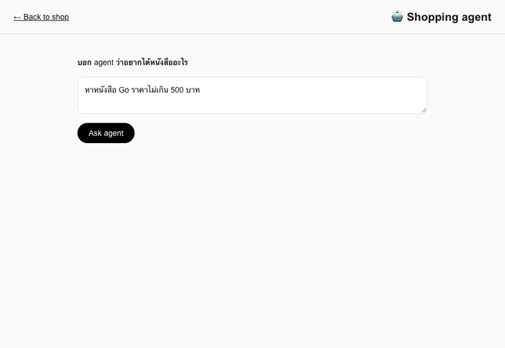
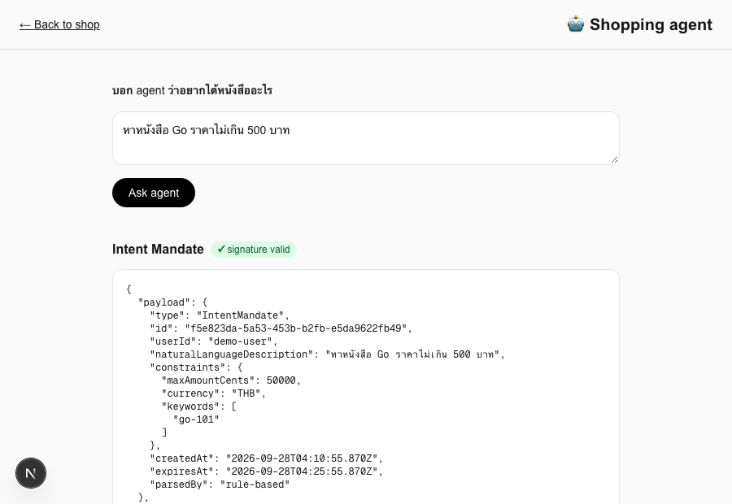

# บทเรียนที่ 2 — Intent Mandate

## เป้าหมาย (Goal)
ให้ user คุยกับ "shopping agent" ด้วยภาษาธรรมชาติ (เช่น "หาหนังสือ Go ราคาไม่เกิน 500 บาท") แล้ว agent แปลงคำขอนั้นเป็น **AP2 Intent Mandate** — object ที่มี constraint ชัดเจน (งบประมาณ, keyword, วันหมดอายุ) และ **เซ็นด้วย digital signature (Ed25519)** เพื่อให้ตรวจสอบได้ว่าไม่มีใครแอบแก้ทีหลัง

## สิ่งที่สร้าง
- `lib/ap2/types.ts` — type ของ `IntentMandate` และ `SignedEnvelope<T>` (โครงสร้างกลางที่ใช้ห่อ mandate ทุกชนิดตลอดเวิร์กช็อป)
- `lib/ap2/sign.ts` — canonical JSON stringify + เซ็น/verify ด้วย Ed25519 (ฝั่ง server, ใช้ Node `crypto`)
- `lib/ap2/verifyClient.ts` — verify signature เดียวกันฝั่ง **browser** ด้วย Web Crypto API
- `lib/ap2/demo-keys.ts` — demo keypair ที่ commit ไว้ในโค้ดตรงๆ (ใช้เพื่อการสอนเท่านั้น)
- `lib/ap2/parseIntent.ts` — ตัว parse ภาษาธรรมชาติแบบ rule-based (regex + keyword matching กับแค็ตตาล็อก) ไม่ต้องใช้ API key
- `lib/ap2/llmIntent.ts` — ตัวเลือกเสริม: parse ด้วย LLM จริงผ่าน **OpenRouter (Gemini 3.8 Flash)** ถ้ามี `OPENROUTER_API_KEY` ใน env ถ้าไม่มีหรือเรียกไม่สำเร็จ จะ fallback กลับไปใช้ rule-based parser อัตโนมัติ
- `app/api/agent/intent/route.ts` — API route: รับข้อความ → parse → สร้าง `IntentMandate` → เซ็น → ส่ง `SignedEnvelope` กลับ
- `app/agent/page.tsx` — หน้าแชทง่ายๆ ให้พิมพ์คำขอ กด "Ask agent" แล้วเห็น mandate ที่เซ็นแล้ว พร้อม badge ว่า signature ถูกต้องหรือไม่ (verify จริงฝั่ง browser)

## ผลลัพธ์จริง (Demo)

ผลลัพธ์สุดท้าย (mandate ที่เซ็นแล้วและ verify ผ่าน):

## ทำไมถึงทำแบบนี้
- **แยก "สิ่งที่ user ตั้งใจ" ออกจาก prompt ที่ลอยๆ**: นี่คือหัวใจของ AP2 — แทนที่จะให้ agent เก็บ context ไว้ในหัวแล้วตัดสินใจเองทุกอย่าง เราบังคับให้มันสรุปความตั้งใจออกมาเป็น object ที่มีโครงสร้างชัดเจน (`constraints.maxAmountCents`, `keywords`, `expiresAt`) ก่อน แล้วจึงเซ็นรับรอง — ทำให้ตรวจสอบย้อนหลังได้ว่า agent ตีความคำขอถูกไหม
- **เซ็นด้วย Ed25519 จริง ไม่ใช่ HMAC**: เพราะ AP2 ต้องรองรับหลายฝ่าย (user agent, merchant, credentials provider) ที่ไม่ได้แชร์ secret เดียวกัน asymmetric signature ทำให้ฝั่งไหนก็ verify ได้ด้วย public key อย่างเดียว โดยไม่ต้องคุยกับผู้เซ็นก่อน — สำคัญมากตอนบทเรียนที่ 6 ที่ merchant ต้อง verify mandate ที่ user เซ็นมาโดยไม่มี private key
- **Verify ซ้ำฝั่ง browser (ไม่ใช่เชื่อ server เฉยๆ)**: จุดประสงค์คือโชว์ว่า mandate ที่เซ็นแล้วต้อง "self-evidently valid" กับใครก็ตามที่ถือ public key ไม่ใช่ต้องเชื่อใจ API ที่ส่งมันมา ถ้า mandate ถูกแก้ระหว่างทาง (MITM) ฝั่ง browser จะ verify ไม่ผ่านทันที
- **rule-based parser เป็น default, LLM เป็นตัวเสริม**: บทเรียนนี้เน้นโครงสร้างของ AP2 ไม่ใช่ NLU ดังนั้นให้ workshop รันได้โดยไม่ต้องมี API key ก่อน แล้วค่อยเปิด LLM จริง (Gemini 3.8 Flash ผ่าน OpenRouter) เป็นทางเลือกสำหรับคนที่ตั้ง `OPENROUTER_API_KEY` ไว้ — โค้ดข้างล่าง (`route.ts`) ไม่สนใจเลยว่า constraints มาจากไหน สนใจแค่ผลลัพธ์ต้องถูกเซ็น — แสดงให้เห็นว่า AP2 ไม่ผูกกับ parser ตัวไหนเป็นพิเศษ

## ต่อยอดอะไรได้ / เอาไปใช้ทำอะไร
- Intent Mandate เดียวกันนี้เอาไปทำ **recurring buy** ได้ (เช่น "ซื้อหนังสือใหม่ในหมวด Programming ทุกเดือน ไม่เกิน 500 บาท") เพราะ constraint ถูกแยกออกมาเป็น object แล้ว ไม่ผูกกับ session การแชทครั้งเดียว
- โครงสร้าง `SignedEnvelope<T>` ใช้ซ้ำได้กับทุก mandate ในบทเรียนถัดไป (Cart Mandate, Payment Mandate) — เขียน sign/verify ครั้งเดียวใช้ตลอดทั้งเวิร์กช็อป
- เปิดทางให้ multi-agent: agent ตัวอื่นรับ Intent Mandate ไปทำงานต่อได้โดยไม่ต้องคุยกับ user ใหม่ ตราบใดที่ signature ยัง valid และยังไม่หมดอายุ

## ทางเลือกอื่นที่พิจารณาแล้ว
- **ใช้ HMAC-SHA256 กับ shared secret แทน Ed25519** — ง่ายกว่าและเร็วกว่า แต่ทุกฝ่ายต้องแชร์ secret เดียวกัน ซึ่งขัดกับโมเดล multi-party ของ AP2 (user agent, merchant, credentials provider ต่างคนต่าง key) เลยเลือก asymmetric ตั้งแต่บทเรียนแรกที่มีการเซ็น เพื่อไม่ต้อง refactor ทีหลัง
- **ให้ LLM เป็น parser หลักตั้งแต่แรก (ไม่มี rule-based fallback)** — จะทำให้ workshop รันไม่ได้ถ้าไม่มี API key และผูก availability ของบทเรียนไว้กับบริการภายนอก จึงเลือกทำ rule-based เป็น default ที่พึ่งพาตัวเองได้ และเปิด LLM เป็นทางเลือกเสริมแทน
- **Verify signature แค่ฝั่ง server อย่างเดียว** — ทำได้ง่ายกว่า (ไม่ต้องยุ่งกับ Web Crypto ในเบราว์เซอร์) แต่จะพลาดประเด็นสำคัญของ AP2 ที่ว่า mandate ต้อง verifiable โดยอิสระจากทุกฝ่าย ไม่ใช่แค่ฝ่ายที่ออก mandate ยืนยันตัวเอง

## หมายเหตุเรื่อง backend
เพิ่ม backend ชิ้นแรกของเวิร์กช็อปในบทเรียนนี้: `app/api/agent/intent/route.ts` เป็น **TypeScript (Next.js API route)** ตามที่วางแผนไว้ — เหมาะสมเพราะเป็นแค่ orchestration (parse → sign → return) ไม่มีความจำเป็นต้องแยกเป็น service อิสระ ส่วน Go จะเก็บไว้ใช้ตอนที่ต้องมี verifier เป็น service แยกจริงๆ (บทเรียนที่ 6)
