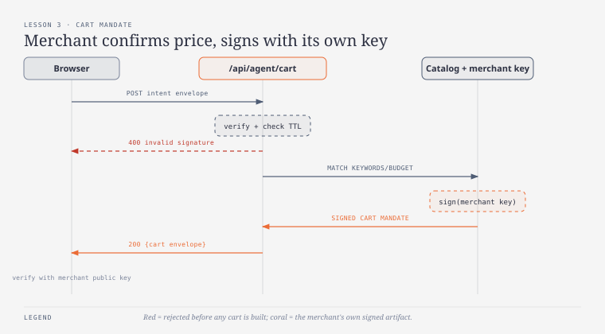
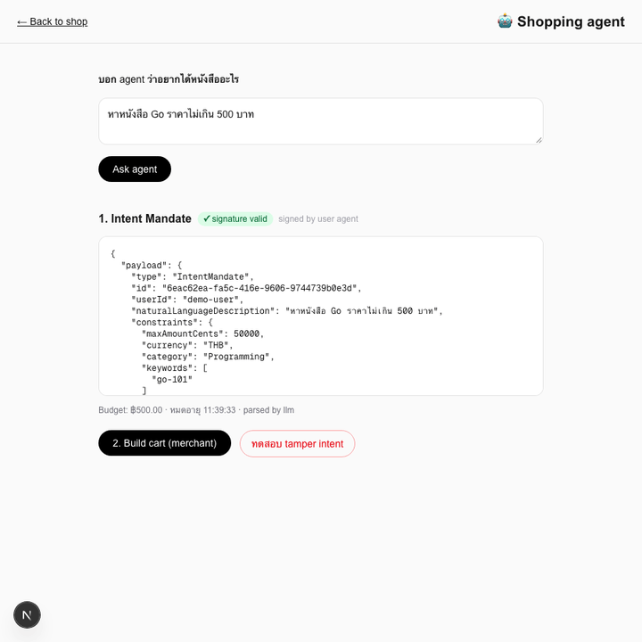
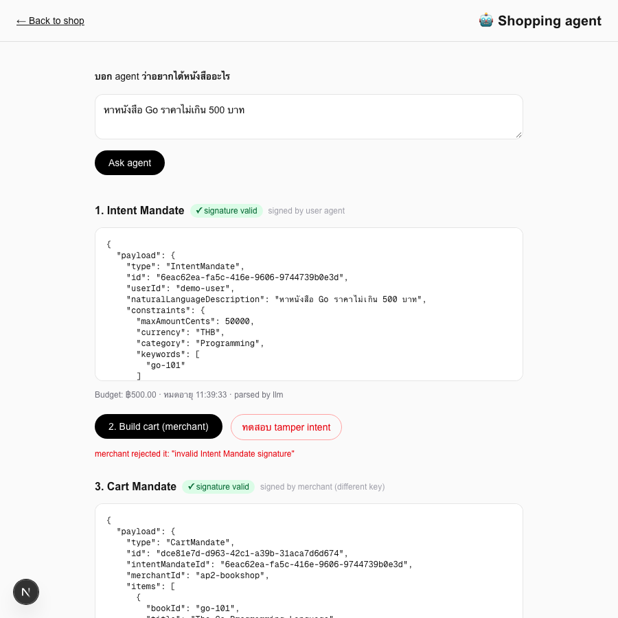

# บทเรียนที่ 3 — Cart Mandate

## เป้าหมาย (Goal)
ให้ agent เลือกสินค้าจริงจากแค็ตตาล็อกตาม Intent Mandate ที่ได้จากบทเรียนที่ 2 แล้วให้ **merchant เซ็นรับรอง** เป็น **Cart Mandate** — object ที่บอกว่า "ฉัน (merchant) ยืนยันว่าจะขายของพวกนี้ในราคานี้" ผูกกลับไปยัง Intent Mandate เดิมด้วย `intentMandateId`

## สิ่งที่สร้าง
- `lib/ap2/types.ts` — เพิ่ม `CartItem`, `CartMandate`
- `lib/ap2/merchant-keys.ts` — demo keypair **คนละชุด**กับ user agent key ในบทเรียนที่ 2 (คนละคู่ private/public key)
- `lib/ap2/buildCart.ts` — เลือกหนังสือจากแค็ตตาล็อกที่ตรงกับ `keywords`/`category` ของ intent แบบ greedy-cheapest-first จนงบหมด
- `app/api/agent/cart/route.ts` — API route: รับ **signed Intent Mandate envelope** → `verifyEnvelope()` เช็ก signature และวันหมดอายุก่อนทำอะไรทั้งนั้น → ถ้าไม่ผ่านตอบ 400 ทันที → ถ้าผ่านค่อยสร้าง cart แล้วเซ็นด้วย merchant key
- `app/agent/page.tsx` — เพิ่มปุ่ม "2. Build cart (merchant)" ต่อจาก Intent Mandate, badge แยกว่า cart เซ็นด้วย "merchant (different key)", และปุ่ม **"ทดสอบ tamper intent"** ที่แก้ `maxAmountCents` ของ intent แล้วยิงไป cart API ซ้ำ เพื่อโชว์ว่า merchant ปฏิเสธทันที

## ผลลัพธ์จริง (Demo)

ผลลัพธ์สุดท้าย — เห็นทั้ง 3 อย่างในหน้าเดียว: Intent ที่ verify ผ่าน, ข้อความ "merchant rejected it" จากการทดสอบ tamper, และ Cart Mandate ที่เซ็นด้วย merchant key:

## ทำไมถึงทำแบบนี้
- **Cart Mandate เซ็นด้วย merchant key ไม่ใช่ user agent key**: นี่คือประเด็นสำคัญที่สุดของบทเรียนนี้ ราคาสินค้าจริง ณ เวลาที่ขาย ต้องมาจากฝั่ง merchant ยืนยัน ไม่ใช่ agent ของ user เขียนขึ้นมาเอง ถ้าใช้ key เดียวกันกับ Intent Mandate จะแยกไม่ออกเลยว่า "ราคานี้ user บอกเอง" หรือ "merchant ยืนยันแล้ว" — พอเป็นคนละ key ก็ตรวจสอบภายหลังได้ชัดเจนว่าใครรับผิดชอบส่วนไหน
- **verify signature ก่อนทำอะไรทั้งหมดใน API route**: ป้องกัน agent (หรือใครก็ตาม) ส่ง intent ที่แก้ไขราคา/งบประมาณเข้ามาแล้วให้ merchant สร้าง cart ตาม เพราะถ้า merchant เชื่อ payload โดยไม่ verify signature ก่อน จะกลายเป็นช่องโหว่ให้ agent โกงงบประมาณของตัวเองได้ ปุ่ม "ทดสอบ tamper intent" ในหน้า UI พิสูจน์ตรงนี้ให้เห็นสดๆ ว่าระบบปฏิเสธจริง ไม่ใช่แค่ทฤษฎี
- **เลือกสินค้าแบบ greedy-cheapest-first**: เป็นกลยุทธ์ที่เข้าใจง่ายและ deterministic (intent เดิม → cart เดิมเสมอ) เหมาะกับการสอน ส่วนกลยุทธ์การเลือกสินค้าที่ซับซ้อนกว่า (เช่น ให้ LLM เลือกเอง) เป็นเรื่องแยกที่ไม่กระทบโครงสร้าง AP2 เลย — สลับใช้ตัวไหนก็ได้ตราบใดที่ผลลัพธ์ยังถูกเซ็นและ verify ได้

## ต่อยอดอะไรได้ / เอาไปใช้ทำอะไร
- โครงสร้างนี้พร้อมสำหรับบทเรียนที่ 4 (human-in-the-loop approval) ทันที: เอา Cart Mandate ที่ merchant เซ็นแล้วไปโชว์ให้ user กด "อนุมัติ" อีกชั้นก่อนจ่ายเงินจริง
- `intentMandateId` ที่ผูกไว้ใน Cart Mandate สร้าง audit trail: ตรวจสอบย้อนหลังได้เสมอว่า cart ใบนี้เกิดจาก intent ใบไหน ใครขอ ขอเมื่อไหร่ งบเท่าไหร่
- Merchant key แยกจาก user agent key เปิดทางให้เพิ่มฝ่ายที่ 3 (credentials provider) ในบทเรียนหลังๆ ได้ตามสเปค AP2 เต็มรูปแบบ โดยไม่ต้องรื้อโครงสร้าง signing เดิม

## ทางเลือกอื่นที่พิจารณาแล้ว
- **ยิง checkout API ตรงๆ โดยไม่มี Cart Mandate แยก** — เร็วกว่าและโค้ดน้อยกว่า แต่จะไม่มี audit trail ว่า merchant ยืนยันราคาไหนตอนไหน และไม่มีจุดให้ verify ก่อน settlement จริง เป็นแนวทางที่ผิดตามที่ระบุไว้ตั้งแต่ตอนวางแผนเวิร์กช็อป
- **ให้ agent (user agent key) เลือกสินค้าแล้วเซ็นเอง แทนที่จะให้ merchant เซ็น** — ทำได้ง่ายกว่าเพราะใช้ key เดียว แต่ผิดหลักการ AP2 ที่ต้องการให้แต่ละฝ่ายรับผิดชอบเฉพาะสิ่งที่ตัวเองยืนยันได้จริง (agent รู้ว่า user อยากได้อะไร แต่ไม่ควรเป็นคนยืนยันว่าของมีจริงราคาเท่านี้)
- **ปฏิเสธแบบเงียบๆ (fail silently) เมื่อ signature ไม่ถูกต้อง** — เช่น คืน cart ว่างเปล่าแทนที่จะ error ชัดเจน จะทำให้ debug ยากและซ่อนปัญหาความปลอดภัยที่ควรเห็นชัดเจนตั้งแต่ตอน dev จึงเลือกตอบ 400 พร้อมข้อความ error ตรงๆ

## หมายเหตุเรื่อง backend
`app/api/agent/cart/route.ts` ยังคงเป็น **TypeScript (Next.js API route)** เพราะยังเป็นแค่ orchestration (verify → build → sign) เหมือนบทเรียนที่ 2 — ยังไม่มีเหตุผลต้องแยกเป็น service อิสระ จะเริ่มพิจารณา Go ตอนบทเรียนที่ 6 ที่ signature verification ต้องเป็น boundary จริงระหว่างระบบที่ไม่ไว้ใจกัน
