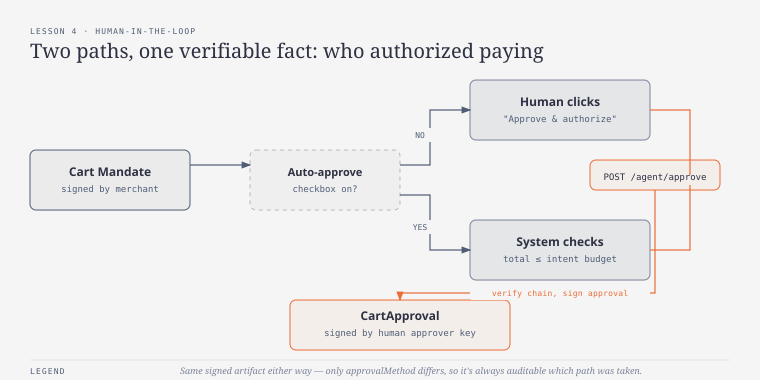
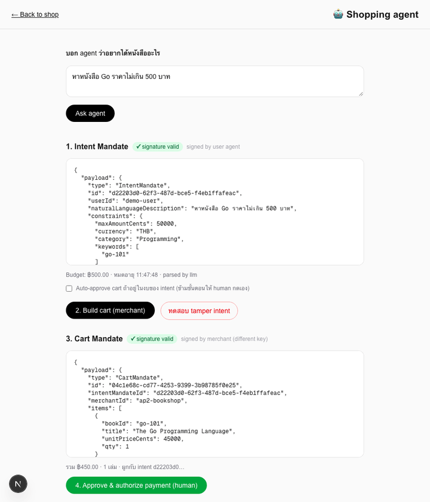
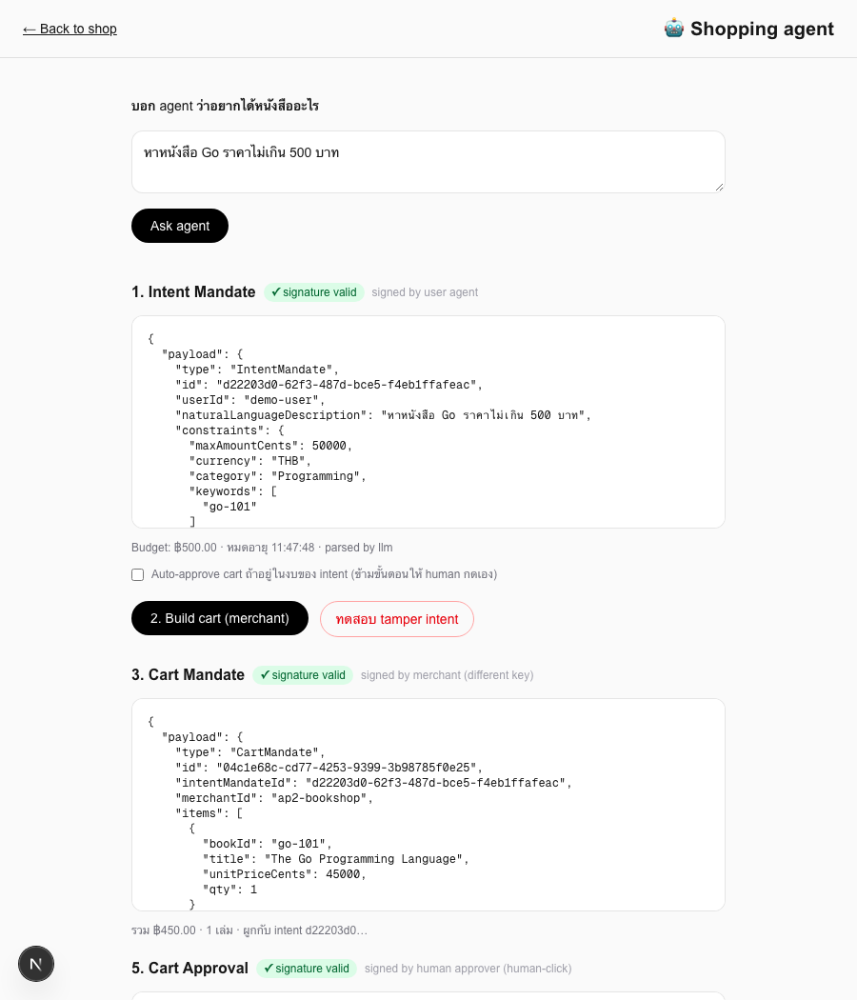

# บทเรียนที่ 4 — Human-in-the-loop approval

## เป้าหมาย (Goal)
เพิ่มขั้นตอนให้ **human ต้องอนุมัติ Cart Mandate จริง** ก่อนที่เงินจะถูกจ่ายออกไป โดยแยกข้อเท็จจริง "agent/merchant ตกลงกันแล้วว่าจะขายอะไรราคาเท่าไหร่" (Cart Mandate) ออกจากข้อเท็จจริง "มีคนอนุมัติให้จ่ายเงินสำหรับ cart นี้จริง" (Cart Approval) อย่างชัดเจน — พร้อมแสดงให้เห็นว่าจะปรับเป็น auto-approve ได้อย่างปลอดภัยแค่ไหน

## สิ่งที่สร้าง
- `lib/ap2/human-keys.ts` — demo keypair ที่ 3 แทน "human approver" (คนละคู่กับ user agent และ merchant)
- `lib/ap2/types.ts` — เพิ่ม `CartApproval` type: ผูกกับทั้ง `cartMandateId` และ `intentMandateId`, มี field `approvalMethod: "human-click" | "auto-approved-within-budget"`
- `app/api/agent/approve/route.ts` — API route ที่ verify **ทั้ง chain**: signature ของ intent, signature ของ cart, cart อ้างอิง intent ถูกต้อง, cart ยังไม่หมดอายุ, และ total ไม่เกินงบของ intent — ผ่านหมดถึงจะเซ็น `CartApproval` ด้วย human key
- `app/agent/page.tsx` — เพิ่ม checkbox "Auto-approve cart ถ้าอยู่ในงบของ intent" และปุ่ม "4. Approve & authorize payment (human)" ที่โผล่มาเฉพาะตอนไม่ได้ติ๊ก auto-approve

## ผลลัพธ์จริง (Demo)

ผลลัพธ์สุดท้าย — เห็นครบ 5 ขั้นตอนตั้งแต่ intent จนถึง approval ที่เซ็นโดย human key:

## ทำไมถึงทำแบบนี้
- **CartApproval เป็นข้อเท็จจริงแยกต่างหาก ไม่ใช่ field ในตัว Cart Mandate**: ถ้าเอา "อนุมัติแล้ว" ไปใส่เป็น field ในตัว Cart Mandate เอง merchant จะกลายเป็นคนรับรองการอนุมัติของ user ไปด้วย ทั้งที่จริงๆ merchant ไม่ควรรู้หรือรับผิดชอบเรื่องนี้เลย การแยกเป็น object คนละใบ เซ็นด้วย key คนละชุด ทำให้เห็นชัดว่า "ใครพูดอะไร" — merchant พูดเรื่องราคา/สินค้า ส่วน human approver พูดเรื่อง "อนุมัติจ่ายเงินแล้ว" เท่านั้น
- **verify ทั้ง chain ใน API route เดียว (intent + cart + linkage + budget)**: เพราะจุดนี้เป็นจุดสุดท้ายก่อนเงินจะเคลื่อน (บทเรียนที่ 5) จึงต้องเป็นจุดที่เข้มงวดที่สุด ตรวจทุกอย่างที่เคยตรวจแยกกันในบทเรียนก่อนหน้าอีกครั้งรวมกันในที่เดียว ป้องกันกรณีที่ cart/intent ที่ผ่าน endpoint อื่นมาแล้ว แต่ไม่ผ่านการเช็ก cross-reference (เช่น cart อ้าง intent ผิดใบ)
- **auto-approve เป็นทางเลือกที่ยังต้องผ่านการเช็ก budget เดิมทุกอย่าง ไม่ใช่ backdoor**: จุดสำคัญคือ auto-approve ไม่ได้ข้ามการ verify ใดๆ เลย มันข้ามแค่ "การรอ human คลิก" เท่านั้น — เงื่อนไข (signature ถูก, budget พอ) เหมือนกันทุกประการกับ manual approve ต่างกันแค่ `approvalMethod` ที่บันทึกไว้ ทำให้ตรวจสอบย้อนหลังได้เสมอว่า transaction ไหนอนุมัติเอง อันไหน human กดจริง

## ต่อยอดอะไรได้ / เอาไปใช้ทำอะไร
- เปิดทางให้ตั้งนโยบายที่ซับซ้อนขึ้นได้ในอนาคต (เช่น auto-approve เฉพาะร้านที่เชื่อถือได้ หรือเฉพาะยอดต่ำกว่าเกณฑ์ที่ต่ำกว่างบ intent อีกชั้น) โดยไม่ต้องแก้โครงสร้าง `CartApproval` เลย แค่เพิ่มเงื่อนไขใน route
- `CartApproval` พร้อมส่งต่อเป็นหลักฐานตอนสร้าง Payment Mandate ในบทเรียนที่ 5 — payment จะเกิดขึ้นได้ก็ต่อเมื่อมี CartApproval ที่ verify ผ่านเท่านั้น เป็นการบังคับ policy "ห้ามจ่ายเงินโดยไม่มี human-in-the-loop (หรือ auto-approve ที่มีเงื่อนไขชัดเจน) มายืนยันก่อน" ในระดับโครงสร้างข้อมูล ไม่ใช่แค่ใน UI
- ปุ่ม "ทดสอบ tamper intent" จากบทเรียนที่ 3 ยังใช้ป้องกัน chain นี้ได้ต่อเนื่อง เพราะ approve route ก็ verify signature ของ intent ซ้ำอีกชั้นเช่นกัน

## ทางเลือกอื่นที่พิจารณาแล้ว
- **รวม approval logic ไว้ใน `/api/agent/cart` เลย (ให้ cart ที่สร้างเสร็จถือว่าอนุมัติอัตโนมัติ)** — โค้ดน้อยกว่า แต่จะทำให้ "merchant ยืนยันราคา" กับ "มีคนอนุมัติจ่ายเงิน" กลายเป็นเหตุการณ์เดียวกัน ซึ่งขัดกับหลักการสำคัญของบทเรียนนี้โดยตรง
- **ใช้ boolean field `approved: true/false` แทนการเซ็น envelope ใหม่** — ง่ายกว่ามาก แต่ boolean เปลี่ยนค่าได้โดยไม่มีใครรู้ (ไม่มี signature ป้องกัน) ทำให้ตอน dispute (บทเรียนที่ 8) ไม่มีหลักฐานยืนยันว่าใครอนุมัติจริง เมื่อไหร่ ด้วยเงื่อนไขอะไร
- **ไม่มี auto-approve เลย บังคับ human คลิกทุกครั้ง**: ปลอดภัยสุดแต่ใช้งานจริงไม่ได้ (ไม่มีใครอยากคลิกอนุมัติทุกครั้งสำหรับ recurring buy เล็กๆ) จึงเลือกเปิดทางเลือกไว้ แต่บังคับให้ auto-approve ต้องผ่านเงื่อนไขเดียวกับ manual ทุกอย่าง เพื่อไม่ให้เป็นช่องโหว่

## หมายเหตุเรื่อง backend
`app/api/agent/approve/route.ts` ยังเป็น **TypeScript (Next.js API route)** เหมือนเดิม เพราะยังเป็น orchestration + verification logic ที่ไม่จำเป็นต้องแยก service — จุดที่น่าจะเริ่มพิจารณาแยกจริงคือบทเรียนที่ 6 (chain-of-custody verification แบบเต็มรูปแบบ) ที่ signature verification อาจต้องเป็น service กลางที่หลายฝ่ายเรียกใช้ร่วมกัน ไม่ใช่ logic ที่ผูกอยู่กับ Next.js app เดียว
