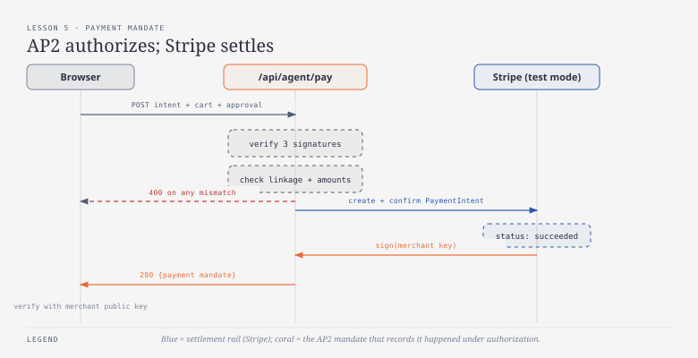
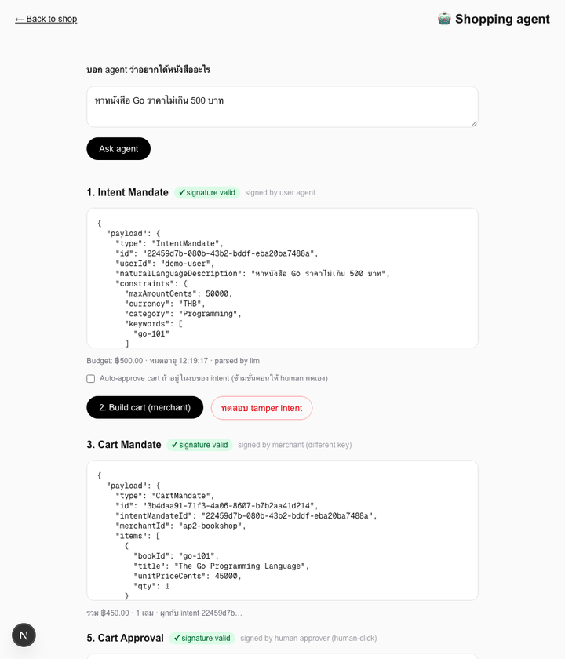
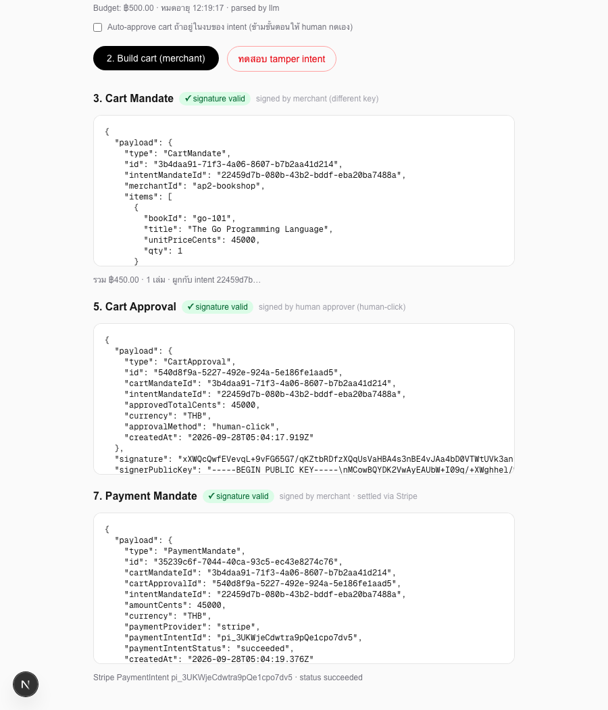

# บทเรียนที่ 5 — Payment Mandate + Stripe settlement

## เป้าหมาย (Goal)
แปลง `CartApproval` ที่ human อนุมัติแล้ว (บทเรียนที่ 4) ให้กลายเป็นเงินจริงที่เคลื่อนไหว โดยเรียก **Stripe** สร้าง PaymentIntent จริงในโหมด test แล้วห่อผลลัพธ์เป็น **Payment Mandate** ที่เซ็นรับรองอีกชั้น — จุดนี้คือรอยต่อระหว่าง "protocol layer" (AP2 mandates) กับ "settlement layer" (Stripe)

## สิ่งที่สร้าง
- `lib/stripe.ts` — Stripe client แบบ lazy-init จาก `STRIPE_SECRET_KEY`, คืนค่า `null` ถ้าไม่ได้ตั้งไว้ (pattern เดียวกับ optional LLM ในบทเรียนที่ 2)
- `lib/ap2/types.ts` — เพิ่ม `PaymentMandate`: ผูกกับทั้ง `cartMandateId`, `cartApprovalId`, `intentMandateId` พร้อม `paymentIntentId`/`paymentIntentStatus` จาก Stripe
- `app/api/agent/pay/route.ts` — verify **signature ทั้ง 3 ใบ** (intent, cart, approval) + เช็ก linkage ระหว่างกันทั้งหมด + เช็กว่า approved amount ตรงกับ cart total ก่อน แล้วค่อยเรียก Stripe สร้าง+confirm PaymentIntent (`pm_card_visa`, test mode) → เซ็น `PaymentMandate` ด้วย merchant key
- `app/agent/page.tsx` — เพิ่มปุ่ม "6. Pay with Stripe (test mode)" และแสดง Payment Mandate พร้อมสถานะจาก Stripe จริง

## ผลลัพธ์จริง (Demo)

ผลลัพธ์สุดท้าย — Payment Mandate พร้อม `paymentIntentStatus: "succeeded"` จาก Stripe test mode จริง:

## ทำไมถึงทำแบบนี้
- **แยก AP2 mandate ออกจาก Stripe object โดยสิ้นเชิง**: `PaymentMandate` ไม่ใช่แค่การ echo ค่าจาก Stripe กลับมา แต่เป็น object ที่เซ็นแยกต่างหาก อ้างอิงกลับไปยัง `cartApprovalId` เสมอ — แปลว่าต่อให้เปลี่ยนไปใช้ payment processor เจ้าอื่น (Adyen, 2C2P, ฯลฯ) โครงสร้าง AP2 ทั้งหมดที่ทำมาตั้งแต่บทเรียนที่ 2–4 ไม่ต้องแก้เลย แค่เปลี่ยน implementation ข้างในบล็อก "เรียก Stripe" เท่านั้น นี่คือเหตุผลที่ AP2 เป็น "authorization/evidence layer" ไม่ใช่ payment processor เอง
- **verify signature ครบทั้ง 3 ชั้นก่อนแตะ Stripe**: จุดนี้เป็นจุดที่เงินจริงเคลื่อนไหว (แม้เป็น test mode) จึงต้องเข้มงวดที่สุดในทั้งเวิร์กช็อป — ตรวจ intent, cart, approval ทุกลายเซ็น รวมถึง cross-reference ทุก id และยอดเงินให้ตรงกันหมด ก่อนจะยอมเรียก `stripe.paymentIntents.create()` แม้แต่ครั้งเดียว
- **ใช้ `pm_card_visa` (test payment method ของ Stripe) แทนการสร้าง Stripe Elements checkout UI เต็มรูปแบบ**: เป้าหมายบทเรียนนี้คือความเข้าใจเรื่องการเชื่อม AP2 เข้ากับ settlement ไม่ใช่การสอนสร้าง UI รับบัตร การใช้ test payment method ที่ Stripe เตรียมไว้ทำให้เห็นผลลัพธ์ `succeeded` จริงจาก API โดยไม่ต้องเพิ่ม scope ของบทเรียนเรื่อง card collection UI

## ต่อยอดอะไรได้ / เอาไปใช้ทำอะไร
- โครงสร้างนี้พร้อมสำหรับบทเรียนที่ 6 (signature verification เต็มรูปแบบ) และบทเรียนที่ 7 (webhook + reconciliation) — `paymentIntentId` ที่เก็บไว้ใน mandate คือ key ที่ใช้ผูกกับ webhook event ที่ Stripe จะส่งมาทีหลัง
- Chain การ verify ที่เขียนไว้ใน `/api/agent/pay` (intent → cart → approval → payment) คือ audit trail แบบสมบูรณ์ตั้งแต่ user พิมพ์คำขอ จนเงินเข้าบัญชี merchant — ใช้เป็นหลักฐานตอน dispute ได้ตรงตามที่วางแผนไว้ในบทเรียนที่ 8
- pattern "lazy client คืน null ถ้าไม่ตั้ง env" ใน `lib/stripe.ts` เอาไปใช้กับ payment processor เจ้าอื่นได้ทันทีถ้าอยากทำ multi-provider settlement

## ทางเลือกอื่นที่พิจารณาแล้ว
- **ยัด cart data ลง Stripe metadata ตรงๆ โดยไม่มี Payment Mandate แยก** — โค้ดสั้นกว่า แต่ metadata ของ Stripe เป็น key-value string ธรรมดา ไม่มีลายเซ็น ไม่มีใครยืนยันได้ว่าไม่ถูกแก้ทีหลัง (Stripe เองก็ไม่ verify ความถูกต้องของ metadata ให้) verify/dispute จึงยากอย่างที่วางแผนไว้ตั้งแต่ตอนออกแบบเวิร์กช็อป
- **สร้าง PaymentIntent แบบ `confirm: false` แล้วให้ browser confirm เองด้วย Stripe.js/Elements** — สมจริงกว่าสำหรับ production แต่เพิ่มความซับซ้อนเรื่อง client-side card element และ 3D Secure ที่ไม่ใช่ประเด็นหลักของบทเรียนนี้ เลือก `confirm: true` พร้อม test payment method แทนเพื่อ focus ที่ AP2 mandate chain
- **ให้ user agent key เป็นคนเซ็น Payment Mandate แทน merchant** — ผิดหลักการเดียวกับบทเรียนที่ 3: merchant คือฝ่ายที่คุยกับ Stripe จริงและรู้ผลลัพธ์ของการ settle เงิน จึงควรเป็นฝ่ายที่ยืนยันข้อเท็จจริงนี้ ไม่ใช่ user agent

## หมายเหตุเรื่อง backend
`app/api/agent/pay/route.ts` ยังเป็น **TypeScript (Next.js API route)** — เหมาะสมเพราะ Stripe SDK มี TypeScript binding ที่ดีอยู่แล้ว และ route นี้ยังเป็นแค่ orchestration (verify chain → call Stripe → sign) ไม่มีเหตุผลต้องแยกภาษา จุดที่ยังวางแผนใช้ Go คือบทเรียนที่ 6 สำหรับ verifier ที่ต้องรันเป็น service อิสระข้าม trust boundary จริง
