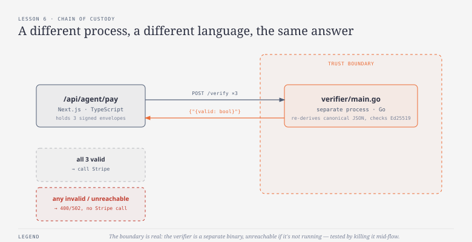
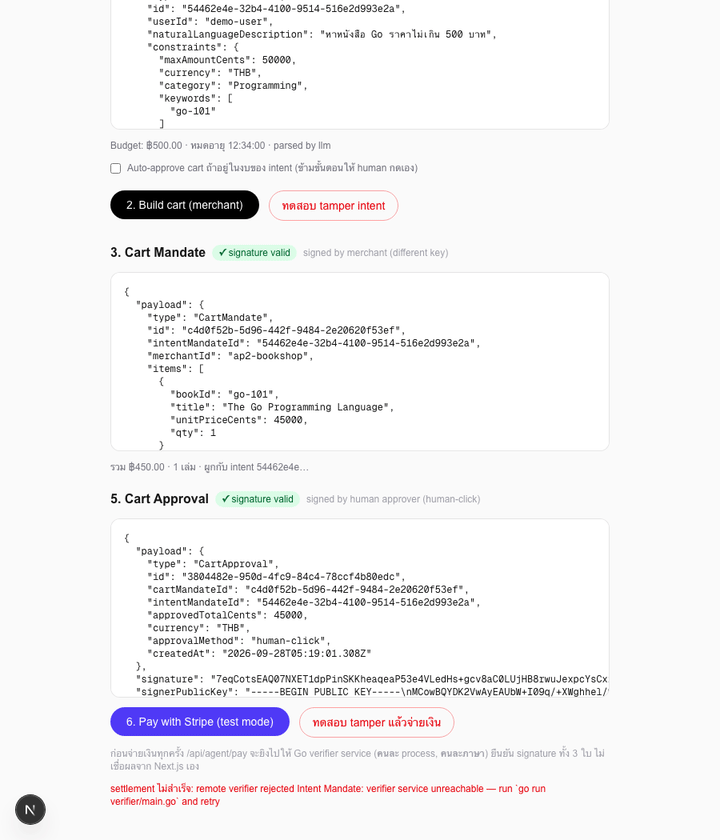
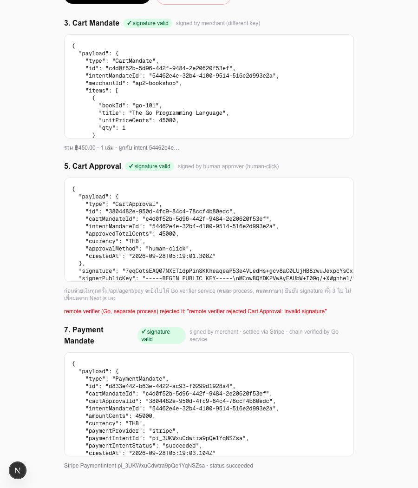

# บทเรียนที่ 6 — Signature verification & chain of custody

## เป้าหมาย (Goal)
จำลอง **trust boundary จริง**: ก่อนเงินจะเคลื่อนไหว (บทเรียนที่ 5) ให้การ verify signature ทั้งสาม (intent, cart, approval) เกิดขึ้นใน **service แยกต่างหาก คนละภาษา คนละ process** จาก Next.js app แทนที่จะให้ Next.js เชื่อผลจาก crypto library ของตัวเอง — พิสูจน์ว่าทำไม "agent ฝั่งเดียวเซ็นเองไม่พอ" ต้องมีการ verify ข้ามระบบจริงๆ

## สิ่งที่สร้าง
- `verifier/main.go` — Go HTTP service แบบ standalone (`POST /verify`) รับ `{ payload, signature, signerPublicKey }` แล้ว **re-derive canonical JSON เองอิสระ** (ไม่ได้เชื่อ TypeScript) แล้ว verify ลายเซ็น Ed25519 ด้วย standard library ของ Go เท่านั้น
- `lib/ap2/verifyRemote.ts` — client ฝั่ง Next.js ที่เรียก Go service แทนการ verify ในโปรเซสตัวเอง ถ้าเรียกไม่ถึง service จะ **fail closed** (ปฏิเสธ ไม่ fallback ไป verify เอง)
- `app/api/agent/pay/route.ts` — เปลี่ยนจาก `verifyEnvelope()` (local) เป็น `verifyEnvelopeRemote()` (เรียก Go) สำหรับ signature ทั้ง 3 ใบ ก่อนจะเรียก Stripe แม้แต่ครั้งเดียว
- `app/agent/page.tsx` — เพิ่มปุ่ม "ทดสอบ tamper แล้วจ่ายเงิน" ที่โชว์ error message ระบุชัดว่า "remote verifier (Go, separate process) rejected it"

## ผลลัพธ์จริง (Demo)
สคริปต์ capture ของบทเรียนนี้ควบคุมวงจรชีวิตของ Go service เอง (kill กลางคัน แล้ว restart) เพื่อให้ได้ภาพจากสถานการณ์ที่เกิดขึ้นจริง ไม่ใช่ mockup:

ผลลัพธ์สุดท้าย — เห็นทั้ง error message จาก tamper test ค้างอยู่ และ Payment Mandate ที่สำเร็จหลัง verifier กลับมาออนไลน์:

## ทำไมถึงทำแบบนี้
- **แยก verifier เป็นคนละภาษา (Go) ไม่ใช่แค่คนละไฟล์ TypeScript**: ถ้า verify logic ยังเป็น TypeScript อยู่ในโปรเซสเดียวกับที่สร้าง mandate ตั้งแต่ต้น การพิสูจน์ "signature ถูกต้อง" ก็ยังเป็นแค่ app เดียวยืนยันตัวเอง (self-attestation) การให้ Go ซึ่งเป็นคนละ runtime คนละ crypto library คนละคนเขียน (ในบริบทสมมติ) **re-derive canonical JSON เองจากศูนย์** แล้วได้คำตอบตรงกัน คือหลักฐานที่หนักแน่นกว่ามากว่า mandate ไม่ได้ถูกปลอมหรือ implementation bug ฝั่งใดฝั่งหนึ่งบังเอิญยอมรับสิ่งที่ไม่ควรยอมรับ
- **ต้องทำ canonical JSON ให้ byte-exact ตรงกันข้าม runtime**: จุดยากที่สุดทางเทคนิคของบทเรียนนี้คือ Ed25519 verify ต้องการ byte ที่ตรงกันเป๊ะกับตอนเซ็น ฝั่ง Go จึง decode ด้วย `json.Number` (กัน float precision) แล้วอาศัยว่า `encoding/json` ของ Go sort key ให้อัตโนมัติเหมือน `Object.keys().sort()` ของ JS ทดสอบแล้วว่า envelope ที่เซ็นจาก TypeScript verify ผ่านที่ Go ได้แบบ byte-exact จริง (และ tamper แล้ว reject ได้จริงเช่นกัน)
- **Fail closed เมื่อ verifier unreachable แทนที่จะ fallback ไป verify เอง**: ถ้า design ให้ fallback กลับไปเชื่อ local verify ตอน remote ล่ม จะทำลายจุดประสงค์ทั้งหมดของบทเรียนนี้ทันที — เพราะสุดท้ายก็จะกลับไปเป็น "self-attestation" เหมือนเดิมทุกครั้งที่ network สะดุด ทดสอบจริงด้วยการ kill โปรเซส Go แล้วกดจ่ายเงิน เห็น error "verifier service unreachable" และไม่มีการเรียก Stripe เกิดขึ้นเลย

## ต่อยอดอะไรได้ / เอาไปใช้ทำอะไร
- โครงสร้างนี้คือจุดเริ่มต้นของ AP2's "credentials provider" role เต็มรูปแบบ — `verifier/main.go` ขยายเป็น service ที่ทำมากกว่าแค่ verify ได้ (เช่น เก็บ audit log ของทุกการ verify, มี rate limit, expose metrics) โดยไม่กระทบ Next.js app เลย
- pattern "fail closed เมื่อ dependency ภายนอกเรียกไม่ถึง" นี้เอาไปใช้กับ dependency วิกฤตอื่นๆ ได้ (เช่น fraud detection service, KYC service) ไม่ใช่แค่ signature verification
- การทดสอบด้วยการ kill process จริงๆ (ไม่ใช่ mock) ในสคริปต์ capture เป็นแนวทางที่ใช้ยืนยัน "graceful degradation" ของ service อื่นๆ ในระบบได้เช่นกัน

## ทางเลือกอื่นที่พิจารณาแล้ว
- **เขียน verifier เป็น TypeScript แยกไฟล์ในโปรเจกต์เดียวกัน (ไม่แยก process/ภาษา)** — ง่ายกว่ามาก ไม่ต้องกังวลเรื่อง canonical JSON ข้าม runtime แต่ไม่ได้พิสูจน์อะไรใหม่เลย เพราะยังรันในโปรเซสเดียวกัน ใช้ crypto library เดียวกัน bug เดียวกันจะกระทบทั้งสองฝั่งเหมือนกัน — ขัดกับเป้าหมายเรื่อง "chain of custody ข้าม trust boundary จริง"
- **ให้ remote verify เป็นแค่ทางเลือกเสริม (fallback ไป local ถ้า remote ล่ม)** — ใช้งานได้ต่อเนื่องกว่าถ้า service ล่มบ่อย แต่เหมือนที่อธิบายไปแล้ว จะทำลายการรับประกันเรื่อง independent verification ที่เป็นแก่นของบทเรียน
- **ใช้ mutual TLS หรือ API key ระหว่าง Next.js กับ Go verifier** — สมจริงกว่าสำหรับ production จริง แต่เพิ่มความซับซ้อนเรื่อง credential management ที่ไม่ใช่ประเด็นหลักของบทเรียนนี้ (ซึ่งเน้นเรื่อง "independent verification" ไม่ใช่ "secure service-to-service auth") เก็บไว้เป็นหัวข้อขยายสำหรับคนที่อยากเอาไป production จริง

## หมายเหตุเรื่อง backend
บทเรียนนี้คือจุดที่ **Go เข้ามาในเวิร์กช็อปจริงๆ เป็นครั้งแรก** ตามที่วางแผนไว้ตั้งแต่บทเรียนที่ 2 — `verifier/main.go` เป็น standalone service ที่ไม่ผูกกับ Next.js process เลย รันด้วย `go run verifier/main.go` แยกต่างหาก คอมไพล์เป็น binary เดี่ยวได้ (`go build`) เหมาะกับงาน verification ที่ต้องพิสูจน์ความเป็นอิสระจาก application layer จริงๆ ส่วน TypeScript (Next.js API routes) ยังคงใช้ทำ orchestration ต่อไปตามเดิม
