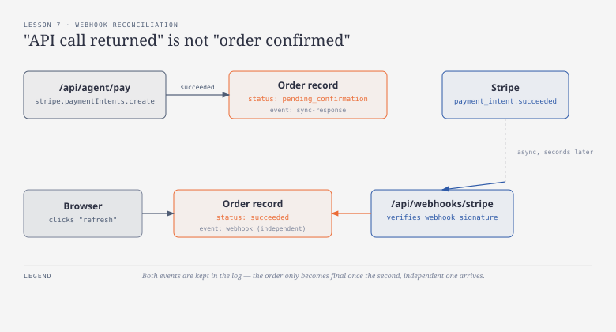
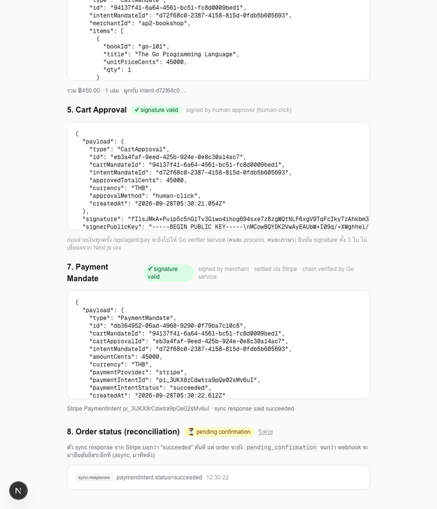
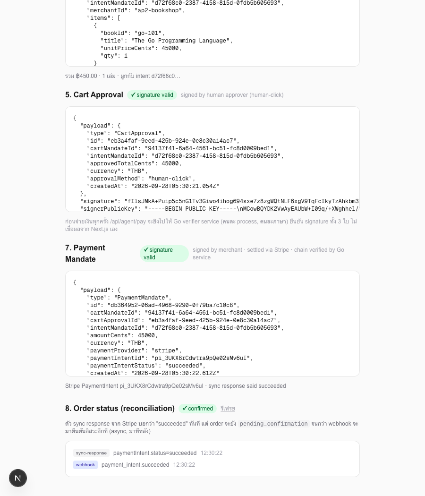

# บทเรียนที่ 7 — Webhook + Reconciliation

## เป้าหมาย (Goal)
แยกข้อเท็จจริงสองอย่างที่คนมักปนกัน: **"เรียก API แล้วได้ response กลับมา"** กับ **"order ได้รับการยืนยันแล้วจริงๆ"** — เพิ่ม Stripe webhook handler ที่ยืนยันสถานะ payment แบบ **async และอิสระ** จาก synchronous response เดิม แล้วผูก log กลับไปยัง mandate chain ทั้งหมดเพื่อ trace ย้อนกลับได้

## สิ่งที่สร้าง
- `lib/orderStore.ts` — in-memory order ledger (เก็บตาม `paymentIntentId`) มี `status: "pending_confirmation" | "succeeded" | "failed"` และ `events[]` ที่บันทึกทุกครั้งที่มีคน "ยืนยัน" สถานะ พร้อม `source` ว่ามาจาก `sync-response` หรือ `webhook`
- `app/api/agent/pay/route.ts` — หลังสร้าง Payment Mandate แล้ว จะสร้าง order เป็น **`pending_confirmation` เสมอ** แม้ Stripe synchronous response จะบอกว่า `succeeded` แล้วก็ตาม — บันทึกไว้แค่เป็น event `sync-response` ไม่ใช่ final state
- `app/api/webhooks/stripe/route.ts` — endpoint รับ webhook จาก Stripe, verify signature ด้วย `STRIPE_WEBHOOK_SECRET`, จับ event `payment_intent.succeeded`/`payment_intent.payment_failed` แล้วเป็นจุดเดียวที่ขยับ order ไปเป็น `succeeded`/`failed` จริง
- `app/api/orders/[paymentIntentId]/route.ts` — endpoint อ่านสถานะ order ปัจจุบัน
- `app/agent/page.tsx` — เพิ่ม "8. Order status (reconciliation)" แสดง badge สถานะ + ปุ่มรีเฟรช + event log ที่เห็นทั้งสอง source แยกกันชัดเจน

## ผลลัพธ์จริง (Demo)
ทดสอบกับ Stripe webhook จริงผ่าน `stripe listen --forward-to localhost:3100/api/webhooks/stripe` (ไม่ใช่ mock) เห็นการเปลี่ยนสถานะจาก pending ไปเป็น confirmed จริง:

ผลลัพธ์สุดท้าย — event log เห็นทั้ง `sync-response` และ `webhook` มาคนละเวลากัน:

## ทำไมถึงทำแบบนี้
- **ไม่เชื่อ synchronous response เป็น final state**: แม้ `stripe.paymentIntents.create({ confirm: true })` จะคืนค่า `status: "succeeded"` ทันที แต่ในโลกจริง payment method บางชนิด (bank redirect, บาง local payment method) ไม่ได้ confirm แบบ synchronous — ต้องรอ webhook เท่านั้นถึงจะรู้ผลจริง เขียน pattern นี้ตั้งแต่ตอนที่ดูเหมือนไม่จำเป็น (เพราะ synchronous ก็ตอบ succeeded อยู่แล้ว) เพื่อให้โค้ดพร้อมสำหรับ payment method อื่นโดยไม่ต้อง refactor
- **เก็บทั้งสอง event แยกกันใน log แทนที่จะ overwrite**: ถ้าระบบเก็บแค่ field `status` เดียวแล้วให้ webhook overwrite ทับ จะไม่มีทางรู้เลยว่า sync response เคยพูดอะไรไว้ก่อนหน้า เวลามีปัญหา (เช่น sync บอก succeeded แต่ webhook บอก failed — กรณีที่เกิดขึ้นได้จริงกับ card ที่ตรวจพบ fraud หลัง auth) จะสืบไม่ได้เลยว่าเกิดอะไรขึ้นระหว่างทาง
- **verify webhook signature ด้วย `STRIPE_WEBHOOK_SECRET` แยกจาก API key**: ป้องกันไม่ให้ใครก็ได้ยิง POST ปลอมมาที่ `/api/webhooks/stripe` แล้วหลอกระบบว่า payment สำเร็จ — Stripe เซ็น webhook payload ด้วย secret คนละตัวจาก API key โดยเฉพาะ

## ต่อยอดอะไรได้ / เอาไปใช้ทำอะไร
- โครงสร้าง `Order` พร้อมขยายเป็นตาราง database จริงได้ทันที (ตอนนี้เป็น in-memory เพื่อโฟกัสที่ pattern ไม่ใช่ schema) — field และ event log ออกแบบมาให้ map ไปตาราง `orders` + `order_events` ได้ตรงๆ
- pattern "sync response ≠ final truth, ต้องรอ async confirmation" เอาไปใช้กับระบบอื่นที่ไม่ใช่ payment ได้เหมือนกัน เช่น shipping confirmation, KYC verification callback
- event log ที่ผูกกับ `intentMandateId`/`cartMandateId`/`cartApprovalId`/`paymentIntentId` ครบทุกใบ คือ audit trail ที่พร้อมใช้ตอน dispute (บทเรียนที่ 8) — ตอบได้ทันทีว่า "ตอนไหน ใครยืนยันอะไรบ้าง"

## ทางเลือกอื่นที่พิจารณาแล้ว
- **เชื่อ synchronous response เป็น final state แล้วข้าม webhook ไปเลย** — โค้ดง่ายกว่ามาก และใช้ได้จริงในกรณีทดสอบนี้ (เพราะ `pm_card_visa` confirm ทันที) แต่จะพังทันทีถ้าเปลี่ยนไปใช้ payment method ที่ async จริง (เช่น PromptPay, bank redirect) ซึ่งเป็นสถานการณ์ที่ระบบจริงเจอบ่อย ตามที่ระบุไว้ตั้งแต่ตอนวางแผนเวิร์กช็อปว่า "จุดที่ระบบจริงพังบ่อย"
- **ใช้ polling อย่างเดียว (เรียก Stripe API เช็คสถานะซ้ำๆ) แทน webhook** — ทำงานได้เหมือนกัน แต่กิน API call เยอะกว่าและมี latency สูงกว่า ไม่สมจริงเท่า webhook ซึ่งเป็นวิธีมาตรฐานที่ Stripe และ payment processor ส่วนใหญ่แนะนำ
- **เก็บ order state เป็น field เดียวไม่มี event log** — เก็บง่ายกว่า แต่เสีย audit trail ที่จำเป็นสำหรับบทเรียนที่ 8 (dispute scenarios) ไปเลย

## หมายเหตุเรื่อง backend
`app/api/webhooks/stripe/route.ts` และ `app/api/orders/[paymentIntentId]/route.ts` ยังเป็น **TypeScript (Next.js API routes)** เหมือนเดิม เพราะเป็นงาน HTTP handling + Stripe SDK integration ตรงไปตรงมา ไม่มีเหตุผลต้องแยกภาษา — Go ในเวิร์กช็อปนี้ยังผูกอยู่กับ `verifier/` เท่านั้นตามที่ตัดสินใจไว้ตั้งแต่บทเรียนที่ 6
