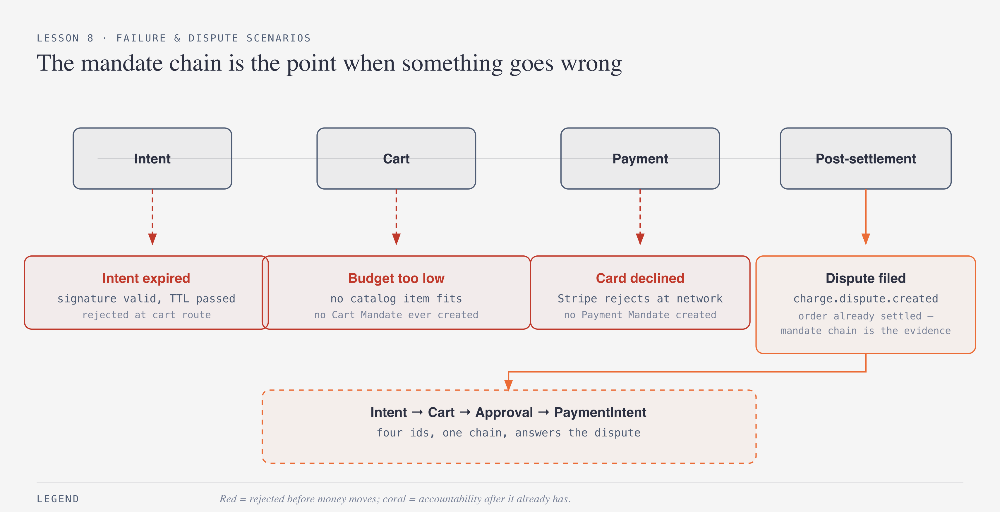
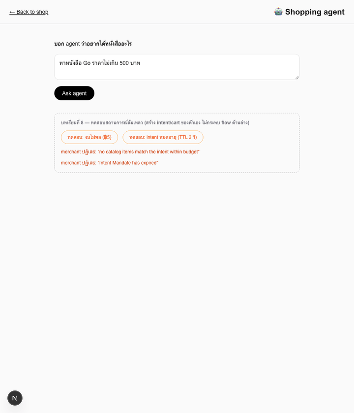
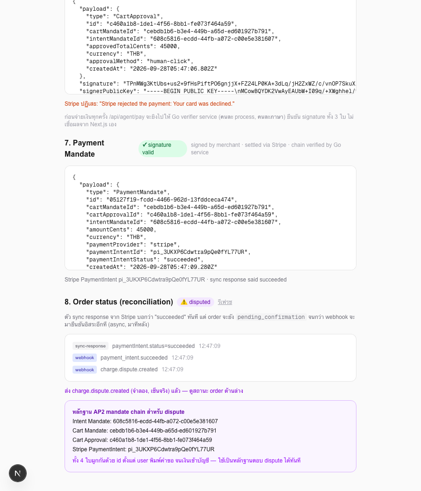

# บทเรียนที่ 8 — Failure & Dispute Scenarios

## เป้าหมาย (Goal)
จำลอง 4 สถานการณ์ที่ระบบจริงต้องเจอ: **agent ตั้งงบเกินจริง**, **mandate หมดอายุ**, **card ถูกปฏิเสธ**, และ **dispute** — เพื่อให้เห็นว่า AP2 mandate chain ที่สร้างมาตลอด 7 บทเรียนไม่ใช่แค่ "protocol สวยๆ" แต่คือ **หลักฐานที่ใช้ได้จริงตอนมีปัญหา** ซึ่งเป็นจุดขายที่แท้จริงของ AP2 — ไม่ใช่ตอน happy path

## สิ่งที่สร้าง
- `app/api/agent/intent/route.ts` — เพิ่ม `ttlSeconds` (dev-only) ให้สร้าง Intent Mandate ที่หมดอายุเร็วแบบ **เซ็นจริง ไม่ใช่ tamper** เพื่อทดสอบ expiry check แยกจาก signature check
- `app/api/agent/pay/route.ts` — เพิ่ม `simulate: "decline"` ให้สลับไปใช้ Stripe test token `pm_card_chargeDeclined` แทน `pm_card_visa`
- `app/api/webhooks/stripe/route.ts` — เพิ่มการจับ event `charge.dispute.created` ยกระดับ order เป็น `disputed`
- `app/api/dev/simulate-dispute/route.ts` — เครื่องมือ dev-only ที่สร้าง webhook event ปลอมแต่ **เซ็นจริง** ด้วย `stripe.webhooks.generateTestHeaderString()` แล้วยิงเข้า webhook endpoint จริงของเราเอง ผูกกับ order จริงที่มีอยู่ (ไม่ใช่ fixture ของ Stripe ที่สุ่มสร้างข้อมูลใหม่แยกต่างหาก)
- `app/agent/page.tsx` — เพิ่มปุ่มทดสอบ 4 สถานการณ์ และ **evidence panel** ที่โชว์ mandate chain ครบ 4 id เมื่อ order ถูก dispute

## ผลลัพธ์จริง (Demo)
รันทั้ง 4 สถานการณ์ในสคริปต์เดียว ไม่มี mockup — ทุก error message มาจาก code path จริง:

ผลลัพธ์สุดท้าย — evidence panel ที่โชว์ mandate chain ครบ 4 ใบตอน dispute:

## ทำไมถึงทำแบบนี้
- **ทดสอบ expiry ด้วย mandate ที่เซ็นจริงแล้วรอหมดอายุจริง แทนการ tamper `expiresAt`**: ถ้า tamper field นี้ตรงๆ จะทำให้ signature ไม่ตรงไปด้วย (เพราะ canonical JSON เปลี่ยน) ผลที่ได้คือ "signature invalid" ไม่ใช่ "expired" ซึ่งเป็นคนละ error กันโดยสิ้นเชิง — เพิ่ม `ttlSeconds` ให้ทดสอบ code path การเช็ก **เวลา** แยกจากการเช็ก **signature** ได้จริง ตรงกับสิ่งที่จะเกิดในโลกจริง (mandate ถูกต้องทุกอย่าง แค่ user เปลี่ยนใจช้าไป)
- **จำลอง dispute ด้วยการเซ็น webhook event เอง แทนที่จะใช้ `stripe trigger`**: `stripe trigger charge.dispute.created` ของ Stripe CLI สร้าง fixture ข้อมูลใหม่แยกจาก PaymentIntent ที่เรามีอยู่ ทำให้ dispute ที่ได้ไม่ผูกกับ order จริงในระบบเรา จึงเลือกสร้าง event ปลอมเอง แต่ **เซ็นด้วย secret จริง** ผ่าน `generateTestHeaderString()` แล้วยิงเข้า webhook route จริงของเรา — วิธีนี้ทำให้ signature verification และ dispute-handling logic ที่รันเป็น production code path จริง ไม่ใช่ shortcut ปลอมๆ ผลที่ได้คือ dispute ผูกกับ order/mandate chain ของเราได้ตรงตามที่ต้องการสอน
- **card declined ต้องไม่สร้าง mandate หรือ order เลย**: เพราะ `stripe.paymentIntents.create()` throw error ก่อนถึงจุดที่เราสร้าง `PaymentMandate`/`Order` โค้ดเดิมจากบทเรียนที่ 5 (try/catch ที่ return ก่อน) จัดการเรื่องนี้ให้แล้วโดยอัตโนมัติ ไม่ต้องแก้อะไรเพิ่ม — พิสูจน์ว่าการออกแบบตั้งแต่แรกที่ "สร้าง mandate เฉพาะตอนสำเร็จจริง" ถูกต้อง
- **evidence panel โชว์ id ทั้ง 4 แบบตรงไปตรงมา**: ไม่ต้อง query อะไรซับซ้อน เพราะ `Order` เก็บ `intentMandateId`, `cartMandateId`, `cartApprovalId`, `paymentIntentId` ไว้ครบตั้งแต่ตอนสร้าง (บทเรียนที่ 7) — จุดนี้คือ payoff ของการออกแบบให้ mandate ทุกใบผูกกันด้วย id ตั้งแต่บทเรียนที่ 3 เป็นต้นมา

## ต่อยอดอะไรได้ / เอาไปใช้ทำอะไร
- Evidence panel นี้ขยายเป็น "export หลักฐานเป็น PDF/JSON ส่งให้ Stripe ตอนตอบ dispute จริง" ได้ทันที เพราะข้อมูลที่ต้องใช้ (ใครขอ, merchant ยืนยันราคาไหน, ใครอนุมัติจ่าย, transaction จริงคืออะไร) อยู่ครบใน `Order` object เดียว
- pattern "สร้าง test event ที่เซ็นจริงด้วย secret จริง" ใน `simulate-dispute/route.ts` เอาไปทดสอบ webhook event ประเภทอื่นได้ทั้งหมด (`charge.refunded`, `payment_intent.requires_action` ฯลฯ) โดยไม่ต้องพึ่ง Stripe fixture ที่ควบคุมข้อมูลผูกกับ order เราไม่ได้
- ปุ่มทดสอบทั้ง 4 ใน UI ทำหน้าที่เป็น **regression test แบบ manual** ให้ทุกครั้งที่แก้โค้ด AP2 chain สามารถกดทดสอบ 4 สถานการณ์นี้ซ้ำได้เร็วๆ ก่อน commit

## ทางเลือกอื่นที่พิจารณาแล้ว
- **ใช้ `stripe trigger` ตรงๆ สำหรับ dispute** — ง่ายกว่ามาก (คำสั่งเดียว) แต่ได้ dispute ที่ไม่ผูกกับ order ของเราเลย เสีย narrative หลักของบทเรียนที่ต้องการโชว์ "mandate chain ตอบ dispute ของ order นี้ได้" จึงยอมเขียนโค้ดเพิ่มเพื่อผูกกับ order จริง
- **เขียน budget/expiry test เป็น unit test (Jest) แทนปุ่มใน UI** — เหมาะกับ CI มากกว่า แต่เวิร์กช็อปนี้เน้นให้เห็นผลลัพธ์แบบ interactive ในเบราว์เซอร์เหมือนบทเรียนอื่นทั้งหมด จึงเลือกทำเป็นปุ่ม UI เพื่อความสม่ำเสมอของประสบการณ์การเรียน ส่วน unit test เป็นเรื่องที่ต่อยอดแยกได้ในโปรเจกต์จริง
- **Mark order เป็น "disputed" ทันทีที่ webhook มาถึงโดยไม่เก็บ event log** — เสีย audit trail ที่สร้างมาตั้งแต่บทเรียนที่ 7 ไปเปล่าๆ ทั้งที่จุดแข็งของบทเรียนที่ 8 คือการโชว์ผลจาก log สะสมที่มีอยู่แล้ว

## หมายเหตุเรื่อง backend
บทเรียนสุดท้ายนี้ไม่ได้เพิ่ม backend ใหม่ — ใช้ **TypeScript (Next.js API routes)** ต่อยอดจากทุกบทเรียนก่อนหน้าทั้งหมด (`intent`, `pay`, `webhooks/stripe`, และ dev tool `simulate-dispute`) ส่วน **Go** (`verifier/`) ยังคงทำหน้าที่ verify signature เป็น trust boundary อิสระเหมือนเดิมตั้งแต่บทเรียนที่ 6 — สรุปแล้วเวิร์กช็อปทั้งหมดใช้ TypeScript เป็น orchestration หลัก และ Go เฉพาะจุดที่ต้องพิสูจน์ความเป็นอิสระข้าม trust boundary จริงๆ ตามที่ตัดสินใจไว้ตั้งแต่บทเรียนที่ 2

---

## สรุปทั้งเวิร์กช็อป

จากบทเรียนที่ 1 (ร้านหนังสือธรรมดา ไม่มี agent) ถึงบทเรียนที่ 8 (dispute) เราสร้าง chain ของ signed mandate 4 ใบ (Intent → Cart → Approval → Payment) ที่แต่ละใบเซ็นด้วย key คนละชุดตามบทบาท (user agent, merchant, human approver) ผ่าน 3 trust boundary จริง (browser verify ฝั่ง client, Go verifier แยก process/ภาษา, Stripe webhook แยก async) — และจบด้วยการพิสูจน์ว่า chain นี้ตอบคำถาม **"ใครอนุญาตอะไร เมื่อไหร่ ทำไม"** ได้ครบถ้วนตอนมีปัญหาจริง ซึ่งคือเหตุผลที่ AP2 มีอยู่ ไม่ใช่แค่ทำให้ agent จ่ายเงินได้ แต่ทำให้จ่ายเงินได้ **อย่างตรวจสอบย้อนหลังได้**
